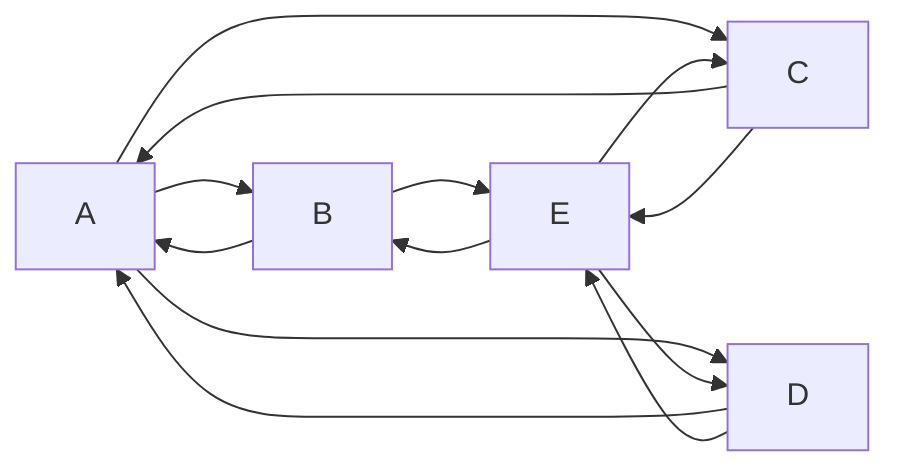

# 마크다운(.md) 정리

> 기준: CommonMark + GitHub(GFM). 앱마다 지원 범위가 조금씩 다르니 최종 확인은 미리보기로 한다.  
> VS Code 미리보기: `Ctrl + Shift + V` (macOS `Cmd + Shift + V`)

---

## 0. 한눈에 보기

| 하고 싶은 것 | 쓰는 법 | 주의 |
| --- | --- | --- |
| 문단 나누기 | 빈 줄 하나 (Enter 두 번) | Enter 한 번은 무시됨 |
| 문단 안 줄바꿈 | 줄 끝 공백 2개, `\`, 또는 `<br>` | 공백은 눈에 안 보여 실수가 잦다 |
| 제목 | `#` ~ `######` + 띄어쓰기 | 7단계는 없다 |
| 구분선 | `---` | 바로 위에 빈 줄 필수 |
| 순서 없는 목록 | `-` `*` `+` + 띄어쓰기 | 하위 목록은 들여쓰기 |
| 순서 있는 목록 | `1.` + 띄어쓰기 | 첫 번호만 의미 있음 |
| 기울임 / 굵게 / 둘 다 | `*글*` / `**글**` / `***글***` | `_`, `__`도 됨 |
| 취소선 | `~~글~~` | GFM 확장 |
| 인라인 코드 | `` `코드` `` | 안의 기호는 서식이 안 먹힘 |
| 코드 블록 | 백틱 3개로 위아래 감싸기 | 뒤에 언어 이름 → 색 입힘 |
| 인용 | `>` | `>>`로 중첩 |
| 링크 / 이미지 | `[글자](주소)` / `` | 이미지는 앞에 `!` |
| 표 | `\| 칸 \| 칸 \|` + `\| --- \| --- \|` | 둘째 줄 없으면 표 안 됨 |
| 체크박스 | `- [ ]` / `- [x]` | GFM 확장 |
| 기호를 글자 그대로 | 앞에 `\` | 이스케이프 |
| 주석(안 보이게) | `<!-- 내용 -->` | VS Code `Ctrl + /` (macOS `Cmd + /`) |

---

## 1. 줄바꿈과 문단

마크다운은 **Enter 한 번을 줄바꿈으로 인정하지 않는다.** 두 줄이 한 줄로 이어 붙는다.

| 입력 | 결과 |
| --- | --- |
| Enter 1번 | 줄바꿈 없음 (같은 줄로 이어짐) |
| Enter 2번 (빈 줄) | 새 문단 (문단 사이 여백 생김) |
| 줄 끝 공백 2개 + Enter | 같은 문단 안에서 줄바꿈 |
| 줄 끝 `\` + Enter | 공백 2개와 같은 효과, 눈에 보여서 실수가 적다 |
| `<br>` | HTML 줄바꿈 태그, 표 칸 안에서도 사용 가능 |

```markdown
첫째 줄
이어 붙음 (Enter 1번)

새 문단 (Enter 2번)

공백 두 개로 줄바꿈··
같은 문단 다음 줄  (·· 자리에 실제로는 공백 2칸)

역슬래시로 줄바꿈\
같은 문단 다음 줄

br 태그로<br>줄바꿈
```

- **GitHub 예외**: 이슈·PR·댓글 칸에서는 Enter 한 번도 줄바꿈으로 보여 준다. 하지만 README 같은 `.md` 파일에서는 위 규칙을 따른다.

---

## 2. 제목 (Heading)

```markdown
# 제목1
## 제목2
### 제목3
#### 제목4
##### 제목5
###### 제목6
```

- `#` 다음에 **반드시 띄어쓰기**. `#제목`은 제목이 아니라 그냥 글자다.
- **제목은 6단계까지.** `#######`(7개)는 제목이 되지 않고 글자 그대로 보인다.
- GitHub는 `#`, `##` 제목 아래에 가로줄을 자동으로 그어 준다. 보통 `#`은 문서 제목(한 번만), `##`은 큰 단락 제목으로 쓴다.
- 제목 단계를 건너뛰지 않는다 (`##` 다음 바로 `####` ✗).

**`#`은 앱마다 뜻이 다르다**

| 쓰는 곳 | `#` + 글자 (띄어쓰기 없이) |
| --- | --- |
| GitHub 이슈·PR·커밋 메시지 | `#12` = 12번 이슈·PR 자동 링크 |
| 옵시디언 | `#태그` = 태그 |
| 슬랙·디스코드 | `#이름` = 채널 |
| 마크다운 본문 | 그냥 글자 (`# ` + 띄어쓰기여야 제목) |

---

## 3. 구분선

`---`, `***`, `___` 중 하나를 한 줄에 단독으로 쓴다.

> **함정** — 글자 바로 아래 줄에 `---`를 쓰면 구분선이 아니라 **그 글자가 제목2가 된다.** (`===`를 쓰면 제목1)  
> 구분선을 원하면 `---` **위에 빈 줄**을 하나 둔다.

```markdown
이 줄은 제목2가 된다
---

이 줄은 그대로 문단

---
```

---

## 4. 목록 (List)

### 순서 없는 목록

```markdown
- 첫 항목
- 두번째 항목
    - 하위 항목 (탭 또는 공백 4칸)
        - 한 단계 더
* 별표도 됨
+ 플러스도 됨
```

- `-`, `*`, `+` 모두 같은 점 목록이다. **한 목록 안에서는 기호를 하나로 통일**한다. 기호를 바꾸면 새 목록으로 끊길 수 있다.
- 기호 뒤 띄어쓰기 필수 (`-항목` ✗).
- 하위 목록 들여쓰기는 탭 또는 공백 2~4칸. 한 문서 안에서 통일한다.

### 순서 있는 목록

```markdown
1. 리센느 - with
2. 리센느 - 백화요란
0. A2O Lite
6. 무엇을 써도 순서대로 나옴
<!-- 주석으로 목록 끊기 -->
1. 끊은 뒤에는 새 목록 (다시 1부터)
```

| 규칙 | 예 | 보이는 결과 |
| --- | --- | --- |
| 첫 항목의 번호가 시작 번호 | `3.` `1.` `1.` | 3, 4, 5 |
| 둘째부터는 어떤 숫자를 써도 1씩 증가 | `1.` `2.` `0.` `6.` | 1, 2, 3, 4 |
| 주석 `<!-- -->` 등으로 끊으면 새 목록 | 끊은 뒤 `1.` | 다시 1부터 |

- 팁: 전부 `1.`로 써 두면 중간에 항목을 끼워 넣어도 번호를 고칠 필요가 없다.
- 숫자+마침표로 시작하는 문장을 목록이 아니게 쓰려면 `2026\. 합격!` 처럼 마침표 앞에 `\`.

---

## 5. 글자 강조

```markdown
*기울이기1* _기울이기2_
**진하게1** __진하게2__
***진하게+기울임***
~~취소선~~
<mark>형광펜</mark>
```

| 쓰는 법 | 결과 | 비고 |
| --- | --- | --- |
| `*기울임*`, `_기울임_` | *기울임* | 한글은 기울임이 잘 안 보이는 글꼴이 많다 |
| `**굵게**`, `__굵게__` | **굵게** | 가장 많이 씀 |
| `***둘 다***` | ***둘 다*** | 별표 3개 |
| `~~취소선~~` | ~~취소선~~ | GFM 확장 |
| `<mark>형광펜</mark>` | <mark>형광펜</mark> | HTML 태그, 렌더러에 따라 다름 |
| `==형광펜==` | (옵시디언 등) | 일부 앱 전용, GitHub에서는 글자 그대로 |

> **한국어에서 굵게가 안 먹히는 경우**  
> `**커밋(Commit)**은` 처럼 닫는 `**` 바로 앞이 괄호·따옴표 같은 문장부호이고, 바로 뒤에 한글이 붙으면 굵게가 적용되지 않고 `**`가 글자로 남는다.  
> 해결: `**커밋**(Commit)은` 처럼 괄호를 밖으로 빼거나, 닫는 `**` 뒤에 띄어쓰기를 둔다.

---

## 6. 코드

### 인라인 코드

문장 안의 짧은 코드는 백틱(키보드 `1` 왼쪽 키) 하나로 감싼다. 안의 서식 기호는 작동하지 않는다.

```markdown
`print()` 함수를 쓴다
`~~취소선~~`  ← 취소선이 아니라 글자 그대로 보임
```

- 코드 안에 백틱이 있으면 백틱 2개로 감싸고 안쪽에 띄어쓰기: ``` `` `코드` `` ```

### 코드 블록

백틱 3개로 위아래를 감싼다. 여는 백틱 뒤에 **언어 이름**을 쓰면 문법에 맞게 색이 입혀진다.

````markdown
```python
print("Hello World")
```
````

| 언어 이름 | 용도 |
| --- | --- |
| `python` | 파이썬 |
| `sql` | SQL 쿼리 |
| `bash` | 터미널 명령 |
| `html` `css` `javascript` | 웹 |
| `json` | 데이터 파일 |
| `text` | 색 없이 그대로 |
| `diff` | `+` 줄 초록, `-` 줄 빨강으로 변경점 표시 |

- 코드 블록 안에 백틱 3개를 보여 줘야 하면 바깥을 **백틱 4개** 또는 `~~~`로 감싼다. (위 예시가 그렇게 작성됨)

### Mermaid 다이어그램

언어 이름을 `mermaid`로 쓰면 글자가 **그림으로** 그려진다. (GitHub, 옵시디언, 노션 지원 / VS Code는 확장 설치 시)



```text
graph LR;          ← 흐름도(graph)를 왼쪽→오른쪽(LR)으로
    A--> B & C & D  ← A에서 B, C, D 각각으로 화살표
    B--> A & E      ← B에서 A, E로
```

| 방향 | 뜻 |
| --- | --- |
| `LR` / `RL` | 왼→오 / 오→왼 |
| `TD`(=`TB`) / `BT` | 위→아래 / 아래→위 |

---

## 7. 인용 (Blockquote)

```markdown
> 인용
> > 인용 안에 인용
> > > 인용 안에 인용 안에 인용

> 여러분들 스트레칭하세요  
> \- 지나가던 프로그래밍 아저씨
```

> 인용
> > 인용 안에 인용
> > > 인용 안에 인용 안에 인용

> 여러분들 스트레칭하세요  
> \- 지나가던 프로그래밍 아저씨

- `> > >`와 `>>>`는 같다. 띄어쓰기는 선택.
- `\-`는 **이스케이프**. 그냥 `- 지나가던…`이라고 쓰면 인용 안의 목록이 되므로, 하이픈을 글자로 보이게 한 것.
- 첫 줄 끝 공백 2개가 없으면 두 줄이 한 줄로 붙는다.

### GitHub 알림 상자

```markdown
> [!NOTE]
> 참고할 내용

> [!WARNING]
> 비밀번호는 절대 커밋하지 마세요.
```

> [!NOTE]
> 참고할 내용

> [!WARNING]
> 비밀번호는 절대 커밋하지 마세요.

종류: `NOTE`, `TIP`, `IMPORTANT`, `WARNING`, `CAUTION` (GitHub 전용, 다른 앱에서는 일반 인용으로 보일 수 있다)

---

## 8. 링크와 이미지

```markdown
[네이버](https://www.naver.com/)
[네이버](https://www.naver.com/ "마우스 올리면 뜨는 설명")
<https://www.naver.com>
[회고 문서](docs/retrospective.md)
[설치 방법으로 이동](#설치-방법)


[](클릭하면이동할주소)

```

| 하고 싶은 것 | 쓰는 법 |
| --- | --- |
| 링크 | `[글자](주소)` |
| 설명 툴팁 붙은 링크 | `[글자](주소 "설명")` |
| 주소 그대로 링크 | `<https://...>` (GitHub는 주소만 써도 자동 링크) |
| 같은 저장소의 다른 파일 | `[글자](docs/파일.md)` 상대 경로 |
| 같은 문서의 제목으로 점프 | `[글자](#제목-이름)` 소문자, 띄어쓰기는 `-` |
| 이미지 | `` |
| 클릭되는 이미지 | `[](이동주소)` |
| 이미지 크기 조절 | `` |

- **대체 텍스트(alt)**: 이미지가 안 뜨거나 화면 낭독기를 쓸 때 대신 보이는 설명. 비워 두지 말고 내용을 적는다.
- `` 처럼 주소를 비우면 이미지가 나오지 않는다.
- 클릭되는 이미지 = **이미지 문법 전체를 링크의 `[ ]` 자리에 넣은 것**.
- GitHub에서 내 이미지는 저장소(예: `images/`)에 올리고 `` 처럼 상대 경로로 쓴다. 내 PC 경로(`C:/...`)는 다른 사람에게 안 보인다.

---

## 9. 표

```markdown
| 이름 | 점수 | 비고 |
| :--- | ---: | :---: |
| 민지 | 95 | 합격 |
| 민수 | 88 | 합격 |
```

| 이름 | 점수 | 비고 |
| :--- | ---: | :---: |
| 민지 | 95 | 합격 |
| 민수 | 88 | 합격 |

| 줄 | 역할 |
| --- | --- |
| 첫 줄 | 제목 행 |
| 둘째 줄 `---` | 제목 행 표시. **없으면 표가 안 된다.** 칸 수는 제목 행과 같아야 한다 |
| `:---` / `---:` / `:---:` | 왼쪽 / 오른쪽 / 가운데 정렬 (숫자 열은 오른쪽이 읽기 쉽다) |

- `|` 기호의 이름은 **수직 바(vertical bar)** 또는 **파이프(pipe)**. 키보드 `Enter` 위 `\`(`₩`) 키를 `Shift`와 함께 누른다.
- 칸 너비를 줄 맞추지 않아도 된다. `|` 개수만 맞으면 된다. 화면에 보이는 칸 너비는 가장 긴 내용에 맞춰 자동으로 정해진다.
- 둘째 줄의 대시(`-`)는 **칸마다 1개 이상**이면 된다. `|-|`, `|:-:|`도 정상 동작한다. 여러 개 쓰는 건 보기 좋게 하려는 것뿐.
- 정렬 기호가 없으면(`---`) 정렬을 지정하지 않은 것이고, 실제 정렬은 렌더러가 정한다. GitHub를 포함한 대부분의 도구에서 내용은 왼쪽 정렬로 보인다. 확실히 왼쪽으로 고정하려면 `:---`를 쓴다.
- 칸 안에 `|` 글자는 `\|`, 줄바꿈은 `<br>`.

**한 칸짜리 표 / 최소 표기**

```markdown
|제목1|
|-----|
|내용1|

|1|
|-|
```

|제목1|
|-----|
|내용1|

|1|
|-|

- 바깥쪽 `|`는 원래 생략할 수 있지만(`제목1 | 제목2`), **한 칸짜리 표는 생략하면 표로 인식되지 않으므로** 양쪽 `|`를 꼭 쓴다. 헷갈리지 않게 항상 양쪽에 쓰는 습관이 안전하다.

**정렬 연습 (필기 예시)**

```markdown
|제목1|제목2|제목3|
|:-----|----:|-----|
|내용1|내용용2|내용3|
|내용123|내용2|내용용용용3|
|내용1456|내용2용용|내용3|
```

|제목1|제목2|제목3|
|:-----|----:|-----|
|내용1|내용용2|내용3|
|내용123|내용2|내용용용용3|
|내용1456|내용2용용|내용3|

제목1 열은 왼쪽(`:---`), 제목2 열은 오른쪽(`---:`), 제목3 열은 기본값(`---`)으로 보인다.
- 표 위아래에는 빈 줄을 둔다.
- 칸 병합은 마크다운 표로는 안 된다 (필요하면 HTML `<table>`).

---

## 10. 체크박스

```markdown
- [x] 완료한 일
- [ ] 남은 일
```

- [x] 완료한 일
- [ ] 남은 일

`[ ]` 안에 띄어쓰기 한 칸 필수. GitHub 이슈·PR 본문에서는 클릭해서 체크할 수 있다.

---

## 11. HTML 섞어 쓰기

| 태그 | 하는 일 | 비고 |
| --- | --- | --- |
| `<br>` | 줄바꿈 | 어디서나 동작 |
| `<!-- -->` | 주석 (화면에 안 보임) | 목록 끊기 용도로도 사용 |
| `<mark>` | 형광펜 | 렌더러에 따라 다름 |
| `<center>` | 가운데 정렬 | HTML 표준에서 폐지된 옛 태그, 무시될 수 있음 |
| `<div align="center">` | 가운데 정렬 | GitHub README에서 쓰는 관례적 방법 |
| `<details><summary>` | 클릭하면 펼쳐지는 접기 | 아래 예시 |
| `<kbd>` | 키보드 키 모양 | `<kbd>Ctrl</kbd> + <kbd>C</kbd>` |
| `<sup>` / `<sub>` | 위첨자 / 아래첨자 | `m<sup>2</sup>`, `H<sub>2</sub>O` |

```markdown
<div align="center">가운데 정렬</div>

<details>
<summary>정답 보기</summary>

정답은 3번이다. (summary 다음에 빈 줄을 둬야 안의 마크다운이 적용된다)

</details>
```

<div align="center">가운데 정렬</div>

<details>
<summary>정답 보기</summary>

정답은 3번이다.

</details>

---

## 12. 이스케이프 문자 `\`

마크다운 기호를 **서식이 아니라 글자 그대로** 보여 주려면 기호 앞에 `\` (한글 자판 `₩`)를 붙인다.

| 입력 | 결과 |
| --- | --- |
| `\*별표\*` | \*별표\* |
| `\# 제목 아님` | \# 제목 아님 |
| `\- 지나가던 아저씨` | \- 지나가던 아저씨 |

이스케이프 가능한 기호: `\` `` ` `` `*` `_` `{}` `[]` `<>` `()` `#` `+` `-` `.` `!` `|`

---

## 13. GitHub에서만 되는 기능

| 기능 | 쓰는 법 | 결과 |
| --- | --- | --- |
| 이슈·PR 연결 | `#12` | 12번 이슈·PR 링크 |
| 사람 부르기 | `@사용자명` | 그 사람에게 알림 |
| 이슈 자동 닫기 | PR 설명에 `Closes #12` | PR 병합 시 12번 이슈 닫힘 |
| 이모지 | `:smile:` `:rocket:` | 그림 문자 |
| 각주 | 본문 `문장[^1]` + 아래 `[^1]: 설명` | 문서 끝 번호 주석 |
| 알림 상자 | `> [!NOTE]` | 7장 참고 |
| 다이어그램 | 코드 블록 언어 `mermaid` | 6장 참고 |
| 수식 | `$E = mc^2$`, 블록은 `$$ ... $$` | LaTeX 수식 |

---

## 14. 자주 하는 실수 체크리스트

- [ ] `#` `-` `1.` `>` 뒤에 띄어쓰기를 했는가
- [ ] 문단 사이, 표·코드 블록·구분선 위아래에 빈 줄이 있는가
- [ ] 제목은 `######`까지만, 단계를 건너뛰지 않았는가
- [ ] 코드 블록을 열었으면 닫았는가 (안 닫으면 아래 전체가 코드가 된다)
- [ ] 굵게 `**`가 글자로 보이지 않는가 (5장 한국어 함정)
- [ ] 이미지 주소가 비어 있거나 내 PC 경로(`C:/...`)는 아닌가
- [ ] 미리보기로 최종 확인했는가