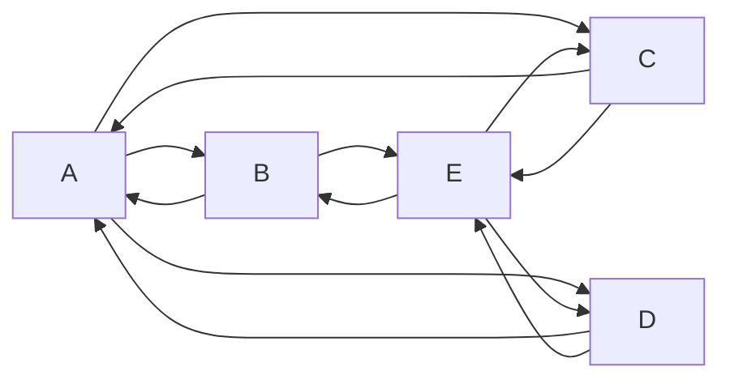

.md - 마크다운
마크다운은 엔터를 줄 바꿈으로 인정하지 X

엔터가 두 번 되어야 다른 문단으로 인식

공백 두 번 (..)을  
같은 문단 내 줄바꿈으로 인식

문단 줄바꿈
문단 내 줄바꿈 <br> 줄바꿈

# 제목1
#옆에 띄어스기 없이 쓰면 안됨. # 다음에 숫자를 붙여서 이슈 호출이나 연관 기능  
옵시디언, 메모 앱들은 # 다음을 ㅗ태글로 씀 (노션, 슬랙, 디스코들...)
## 제목2
### 제목3
###### 제목6
####### 제목7  
(일반적으로 #, ##은 구분선을 사용해서 제목과 부제목을 의미)

---

순서 없는 리스트  
- 순서가 없음  
- 내가 좋아하는건  
    - tap 사용한 들여쓰기  
* 별표도 됨  
+ 플러스도 됨

순서 있는 리스트

1. 리센느 - with  
2. 리센느 - 백화요란  
0. A2O Lite  
6. 숫자 쓰기 시작하면 무엇을 쓰든 숫자 순서대로 나옴  
<!-- ctrl + / -->
1. 나누고 나서는 이어지지 않음  
<!--  -->
 *기울이기 1* _기울기기 2_  
 __진하게1__ **진하게2**   
 ~~취소선~~  <mark> 형관펜 태그  </mark>  
 `~~취소선~~`
` ` - 인라인 코드
```
코드박스
12345678
```

```python
print("Hello World")
```



> 인용
> > 인용 안에 인용
> > > 인용 안에 인용 안에 인용

> 여러분들 스트레칭하세요  
> \- 지나가던 프로그래밍 아저씨
<!-- \ 이스케이프 문자 -->
 >인용
 >>인용 안에 인용
 >>> 인용안에 인용 안에 인용

 >스트레칭 하세요  
 
[연결하고 싶은 문자](https://www.naver.com/)  


  
```
[](접속링크)
```

<center>가운데 정렬</center>


`| (수직 바, 파이프라인)`

|제목1|
|-----|
|내용1|

|제목1|제목2|제목3|
|:-----|----:|-----|
|내용1|내용용2|내용3|
|내용123|내용2|내용용용용3|
|내용1456|내용2용용|내용3|

|1|
|-|

```
|:---| |---| 왼쪽 정렬 (기본값)
|---:| 오른쪽 정렬
|:---:| 가운데 정렬
```